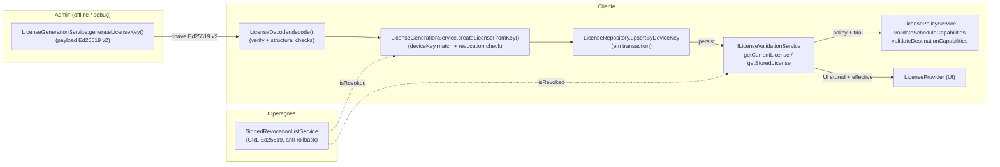

# Onboarding — Licenciamento

Resumo curto do fluxo de licenciamento do `backup_database`. Para o
"porque" detalhado, ver **ADR-016**
(`docs/adr/016-licensing-audit-secret-handling-and-revocation.md`).
Para padrões obrigatórios, ver **`.cursor/rules/architectural_patterns.mdc §10`**.

## Cadeia ponta a ponta



## Camadas principais

| Camada | Arquivos chave |
|---|---|
| Domain | `lib/domain/entities/license.dart` (`isExpired`, `isNotYetValid`, `isValid`); `lib/domain/services/i_license_validation_service.dart`; `lib/domain/services/i_license_policy_service.dart`; `lib/domain/services/i_revocation_checker.dart`; `lib/domain/repositories/i_license_repository.dart` |
| Application | `license_decoder.dart` (porta `LicenseSignatureVerifier`, sem import de infra); `license_decoder_factory.dart` (`fromEnv`); `license_trial_policy.dart`; `license_generation_service.dart`; `license_validation_service.dart`; `cached_license_validation_service.dart` (TTL 5s); `license_policy_service.dart` (cache por `runId`); `revocation_check_helper.dart`; `admin_password_verifier.dart`; `license_provider.dart` (stored + effective) |
| Infrastructure | `lib/infrastructure/license/ed25519_license_verifier.dart`; `lib/infrastructure/license/signed_revocation_list_service.dart` (anti-rollback); `lib/infrastructure/license/revocation_list_issued_at_store.dart`; `lib/infrastructure/repositories/license_repository.dart` (upsert em transaction); `lib/infrastructure/external/system/device_key_service.dart` (memoizado); `lib/infrastructure/datasources/local/tables/licenses_table.dart` (com `not_before`) |
| Presentation | `lib/presentation/widgets/settings/license_settings_tab.dart` (status + gerador admin gated) |
| Core (guard) | `lib/core/config/environment_loader.dart` — `forbiddenInBundledAssetKeys` |

## Avaliação automática (trial full/free)

Até o **fim de 01/10/2027** (incluso em America/Sao_Paulo; instante
global `2027-10-02 00:00:00-03:00` = `DateTime.utc(2027, 10, 2, 3)`):

- Qualquer instalação tem **avaliação completa automática** — catálogo
  inteiro, **sem colar chave**. Política no binário
  (`LicenseTrialPolicy`), não uma licença Ed25519 empacotada.
- Premium colada **substitui** o trial (vale o SKU assinado; sem união
  com “tudo liberado”).
- Device na **CRL** não usa avaliação.

**Depois do corte**, sem premium válido: **downgrade, não lock**. Backup
**full + destinos local/FTP** continua. Features premium (Drive/Dropbox/
Nextcloud, diferencial, log, intervalo, checksum, verify, script, e-mail,
`server_connection`) falham na **execução e no save** que as exige.
Agendamentos e destinos **não são apagados**.

`getCurrentLicense` pode devolver o sintético (`id: trial`,
`licenseKey: trial:full-free`). `getStoredLicense` **nunca** devolve o
sintético. Linha persistida expirada/notBefore **não** aborta o trial.

Overrides só em **debug** (`LICENSE_TRIAL_FORCE_ENDED`,
`LICENSE_TRIAL_ENDS_AT`) — ignorados em release. Relógio do SO atrasado
pode estender o trial (risco aceito no modelo offline). Decoder
indisponível afeta só o **paste** de chave premium; o trial não depende
dele.

A CRL usa o **mesmo mapa** `PUBLIC_KEY` + `PUBLIC_KEYS` e o `keyId` do
payload (sem tentar todas as chaves).

## Configuração obrigatória

### Em qualquer ambiente

- Configure ao menos uma chave pública de verificação válida (32 bytes
  Ed25519 em base64). Chaves públicas podem estar no asset do aplicativo.
- Prefira `BACKUP_DATABASE_LICENSE_PUBLIC_KEYS`, um mapa JSON de `keyId`
  para chave pública. Após a retirada da chave comprometida, mantenha
  somente a chave nova nesse mapa.
- `BACKUP_DATABASE_LICENSE_PUBLIC_KEY` é a opção legada, associada a
  `ed25519-1`. Não é obrigatória se o mapa estiver configurado. As duas
  fontes são mescladas, com precedência do mapa em colisões; remover a
  chave antiga apenas do mapa não basta se o campo legado ainda a contém.

### Em dev/admin (NUNCA no asset bundled)

Somente na estação autorizada a emitir licenças, coloque em
`C:\ProgramData\BackupDatabase\config\.env`:

```bash
# Chave privada Ed25519 para emitir licenças (64 bytes base64).
# Gere com: dart run scripts/generate_license_keypair.dart ed25519-2 C:\PrivateSigning
BACKUP_DATABASE_LICENSE_PRIVATE_KEY=<base64>

# keyId que NOVAS licenças geradas vão carregar no payload.
# Deve corresponder ao identificador do novo par gerado.
BACKUP_DATABASE_LICENSE_ACTIVE_KEY_ID=ed25519-2

# Hash da senha admin do gerador embutido.
# Gere com: dart run scripts/hash_admin_password.dart 'minhasenha'
LICENSE_ADMIN_PASSWORD_HASH=pbkdf2-sha256$200000$...$...

# Opcional: lista de revogação assinada.
BACKUP_DATABASE_LICENSE_REVOCATION_LIST_PATH=C:\ProgramData\BackupDatabase\config\revocation_list.json
```

### Em produção (cliente)

- Distribua somente as chaves públicas de verificação e, opcionalmente,
  configure `BACKUP_DATABASE_LICENSE_REVOCATION_LIST_PATH` para a CRL.
  Nunca copie a chave privada de emissão ou o hash administrativo aos clientes.
- Os campos secretos ficam **vazios** nos quatro arquivos de distribuição:
  `.env`, `.env.example`, `.env.client` e `.env.server`. O teste
  `test/unit/core/config/bundled_env_secret_leak_test.dart` verifica os campos
  proibidos e informa apenas seus nomes ao falhar. Veja os
  [limites dessa proteção](../security/logging-and-secrets.md).

## "Como faço para…"

### …rotacionar a chave Ed25519 (key rotation graceful)?

A chave atual deve ser rotacionada quando:

- Como prática preventiva periódica (a cada N meses).
- Após dispensar admin que tinha acesso à private key.

O sistema suporta **rotação graceful**: a chave antiga continua válida
para licenças já emitidas enquanto a chave nova é introduzida.

**Não use esse período de coexistência para encerrar uma exposição de chave
privada.** Para o incidente do histórico público, siga
[o procedimento de comprometimento](../security/license-key-rotation.md).
Enquanto a chave antiga for aceita, licenças forjadas continuam possíveis.

**Passos:**

1. Em uma máquina dev/admin, gere o novo par:

   ```bash
   dart run scripts/generate_license_keypair.dart ed25519-2 C:\PrivateSigning
   ```

   A pasta de destino deve existir e estar fora do repositório. O script
   cria uma subpasta exclusiva com acesso restrito ao operador e SYSTEM
   no Windows (modo 700 em outros sistemas). Grava `signer.env` privado
   e `public.env` público; não imprime a chave privada nem altera o app.

2. **No `.env` do repositório** (asset bundled), substitua a entrada
   única por um JSON com as duas chaves:

   ```bash
   # Mantém a chave antiga aceita para licenças já emitidas:
   BACKUP_DATABASE_LICENSE_PUBLIC_KEYS={"ed25519-1": "<chave_antiga_base64>", "ed25519-2": "<chave_nova_base64>"}
   ```

   Deixe `BACKUP_DATABASE_LICENSE_PUBLIC_KEY` vazio para que o conjunto
   aceito fique explícito no mapa. Confira também a configuração externa,
   que pode manter uma chave legada independentemente do bundle.

3. **No `.env` externo** (`C:\ProgramData\BackupDatabase\config\.env`)
   de cada estação admin:

   ```bash
   BACKUP_DATABASE_LICENSE_PRIVATE_KEY=<chave_nova_privada_base64>
   BACKUP_DATABASE_LICENSE_ACTIVE_KEY_ID=ed25519-2
   ```

4. Faça build e distribua para todos os clientes. Eles **continuam**
   aceitando licenças `ed25519-1` enquanto migram.

5. Re-emita as licenças ativas usando o gerador (agora assina com
   `ed25519-2`).

6. Quando todos os clientes tiverem licenças `ed25519-2`, **remova**
   a entrada `ed25519-1` do JSON `BACKUP_DATABASE_LICENSE_PUBLIC_KEYS`
   **e esvazie `BACKUP_DATABASE_LICENSE_PUBLIC_KEY`**, tanto no bundle
   quanto na configuração externa das instalações.
   Refaça o build e distribua. Licenças antigas
   passam a ser rejeitadas (`keyId desconhecido: ed25519-1`).

**Verificação:**

- Log de boot: `LicenseGenerationService initialized with
  activeKeyId="ed25519-2" (decoder accepts: ed25519-1, ed25519-2)`.
- Diretamente no decoder em testes/REPL: `decoder.acceptedKeyIds`.
- Licença gerada: o payload contém `"keyId": "ed25519-2"` (visível
  fazendo `base64 -d` da chave e extraindo o `data.keyId`).

### …emitir uma licença para um cliente?

1. Pegue o `deviceKey` do cliente (ele copia da tela de Licenciamento).
2. Em uma máquina dev com `BACKUP_DATABASE_LICENSE_PRIVATE_KEY`
   configurada e em `kDebugMode`, abra o app → Configurações →
   Licenciamento → Acessar gerador → digite a senha admin → preencha
   `deviceKey`, features e `expiresAt`.
3. Copie a chave gerada (base64) e envie ao cliente. Ele cola na tela
   de Licenciamento dele e clica em "Validar licença".

### …revogar uma licença?

1. Edite o JSON da CRL (formato `{ "data": { "revokedDeviceKeys": [...], "issuedAt": "ISO-8601", "expiresAt": "ISO-8601?" }, "signature": "base64" }`).
2. **Importante**: o `issuedAt` da nova CRL precisa ser **estritamente
   maior** que o último aceito pelo cliente — se você publicar uma
   CRL com `issuedAt` retroativo, o anti-rollback do
   `SignedRevocationListService` rejeita.
3. Assine com a private key (`ed25519_edwards.sign(...)`), salve no
   path apontado por `BACKUP_DATABASE_LICENSE_REVOCATION_LIST_PATH`
   ou base64 em `BACKUP_DATABASE_LICENSE_REVOCATION_LIST`.
4. O cliente vai recarregar a CRL no próximo `isRevoked()` (cache TTL
   15min por default — ver `LicenseConstants.revocationListTtl`).

### …gerar/atualizar o hash da senha admin?

```bash
dart run scripts/hash_admin_password.dart 'minhaSenhaForte123!'
```

Copie o output em `LICENSE_ADMIN_PASSWORD_HASH=...` no `.env` externo
de cada estação dev/admin.

O utilitário atual recebe a senha como argumento e imprime o hash. Execute
somente em estação confiável: a senha pode aparecer no histórico do shell e
na lista de processos. Não execute em CI, terminal gravado ou sessão
compartilhada, e trate o hash gerado como informação sensível.

### …adicionar uma feature nova de licença?

1. Adicione constante em `lib/core/constants/license_features.dart`
   (e na lista `allFeatures`).
2. Adicione check no `LicensePolicyService` se a feature está
   associada a propriedade de `Schedule` (ex.: `enableChecksum`).
3. Adicione label de UI em `_getFeatureLabel` em
   `lib/presentation/widgets/settings/license_settings_tab.dart`.
4. Inclua a feature no payload das licenças que devem tê-la (re-emita
   as licenças afetadas).

### …entender por que minha feature aparece negada na UI?

Olhe os logs (`LoggerService.debug`/`warning`):

- `isFeatureAllowed("<feature>") = false` — vem de
  `LicenseValidationService.isFeatureAllowed`, com causa raiz (sem
  licença, expirada, etc).
- `LicenseProvider.isFeatureAllowed("<feature>") = false` — fail-closed
  geral; raro, só em erros técnicos.
- `Sem fonte de revogação configurada` — quando o `IRevocationChecker`
  é null/sem env (fail-open, log único).

## Anti-patterns (linkados em §10 do `architectural_patterns.mdc`)

- ❌ Comitar `BACKUP_DATABASE_LICENSE_PRIVATE_KEY` no `.env` do repo.
- ❌ `revocationChecker?.isRevoked(deviceKey) ?? false` direto —
  use `RevocationCheckHelper.isRevokedSafe`.
- ❌ `getCurrentLicense` sozinho para mostrar status na UI (esconde
  expiradas e mistura trial) — carregue **stored + effective**;
  `isFeatureUnlocked` lê o effective em memória.
- ❌ Persistência do sintético de trial no Drift.
- ❌ Comparar senha admin em texto plano — use `AdminPasswordVerifier`.
- ❌ Cache de feature no `LicensePolicyService` chaveado por algo que
  não seja `runId`.

## Pendência operacional de segurança

A chave privada exposta no histórico deve ser substituída conforme o
[procedimento de comprometimento](../security/license-key-rotation.md).
A preparação do gerador não executa a troca: ainda é necessário gerar a
chave de produção, reemitir licenças/CRL, atualizar configurações e publicar
uma versão que deixe de aceitar a chave antiga.

## Melhorias futuras

- **JSON canônico (RFC 8785)** na assinatura — proteção contra
  mudanças futuras do `jsonEncode` do SDK (ver Opção A do ADR-016).
- **Mover gerador admin para binário separado**, fora do bundle cliente
  (ver Opção B do ADR-016).
